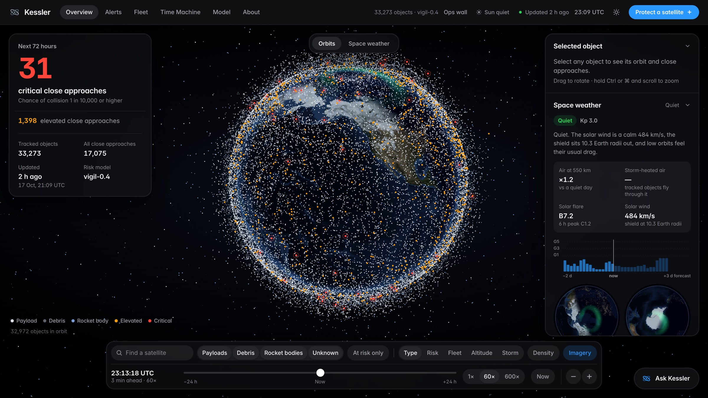

# Kessler

**Mission control for everyone else:** collision-risk monitoring for the satellite
operators that enterprise space-traffic services don't serve, like university CubeSat
teams and smallsat startups.

[](https://github.com/nickvaz09/kessler/actions/workflows/ci.yml)
[](LICENSE)




Kessler ingests public orbital data (CelesTrak and Space-Track TLEs, Space-Track
conjunction messages) and uses SGP4 to screen CubeSats and crewed stations against
every low-Earth-orbit object in a catalog of about 33,000, over the next 72 hours.
On top of that:

- **VIGIL**, a machine-learning risk model trained on ESA's Kelvins conjunction
  dataset. On its own held-out split it cuts overall error by 21% against the
  carry-forward baseline, and every prediction is stored with the model version
  that produced it. On ESA's official test set (2,167 real events) the VIGIL Lab's
  benchmark build scored 0.661, against 0.684 for ESA's own AI (the only one of the
  5,000 models ESA trained to beat the baseline on both its training and test data)
  and 0.694 for the standard method. Lower is better, and the edge is inside the
  pre-set 97.5% margin of error.
- **VIGIL-E early warning** (research build): a classifier for events that are
  still nominal but likely to become high-risk before closest approach, the
  "should I start worrying now?" decision. It passed its pre-registered test
  against a fitted baseline (PR-AUC 0.126 vs 0.065), but a later re-check found
  that baseline weakened by how its cross-validated scores were pooled. Against the
  latest risk itself (0.098) the gain is not significant, so the app doesn't ship
  it. As a false-alarm filter, VIGIL's classifier does help: on ESA's data it
  removes 28% of the baseline's false alarms while keeping 95% of its true calls
  (the latest risk alone removes 9%).
- **Space weather**: live NOAA SWPC conditions feed the same globe, screening and
  assistant. NRLMSIS 2.1 turns a storm into air density at each object's altitude,
  and each close approach gets a storm-drift widening of its uncertainty and a
  flag to recheck it. Stored risk is never lowered.
- **Kessler AI**, an operations assistant (a Claude tool loop with 27 tools) that
  answers from live data, drives the interface, plans avoidance burns, writes
  printable reports and narrates encounter replays.
- **One-click avoidance plan**: the smallest along-track burn, at several lead
  times, that moves an encounter below the alert line, replayed before and after
  in the encounter simulator (screening-grade, and labeled so).
- **Time Machine**: the 2009 Iridium 33 / Cosmos 2251 collision replayed through
  Kessler's own screening pipeline, followed by an illustrative debris-cascade
  model.
- **Protect a satellite**: a 60-second onboarding that screens any cataloged
  satellite, pasted TLE or planned orbit and explains the result in plain language.
- **Automatic maneuver flags**: likely orbit changes, found from element jumps
  across the TLE history (rule-based).

It all runs in one interface with no frontend framework: a full-screen live globe
of the catalog, an alert inbox, object pages, a model card and an ops wall, in light
and dark. The name comes from the Kessler syndrome, the cascade of collisions in low
Earth orbit that this exists to help prevent.

## Quickstart

```bash
python3 -m venv .venv
.venv/bin/pip install -r requirements.txt

# Optional but recommended: credentials for Space-Track CDMs and Kessler AI.
cp .env.example .env   # edit, then: set -a; source .env; set +a

# Ingest the catalog, screen 72 h of conjunctions, score risk. The full catalog
# needs KESSLER_FULL_CATALOG=1 and Space-Track credentials (CelesTrak's 'active'
# group blocks scripted clients, so CelesTrak-only runs are small). --demo also
# backfills labeled synthetic CDM sequences, so trend charts have history on a
# fresh database (see "Real and demo data" below).
.venv/bin/python -m backend.app.ingestion.pipeline --demo

# Serve the API and the dashboard on http://127.0.0.1:8000
.venv/bin/uvicorn backend.app.main:app --reload
```

## Architecture

```
CelesTrak · Space-Track (TLEs, CDMs)        ESA Kelvins CDM archive (training)
        │                                            │
        ▼                                            ▼
backend/app/ingestion/                      backend/app/models/
  celestrak.py / spacetrack.py  fetch         pc.py            screening Pc
  propagate.py   SGP4 propagation             risk_model.py    VIGIL (xgboost)
  screening.py   close-approach search        escalation.py    VIGIL-E early warning
  pipeline.py    orchestration                maneuver.py      burns + avoidance plan
        │                                     train*.py        ship-gated training
        └──────► SQLite or Postgres ◄───────────────┘
                        │           backend/app/scenarios/  Time Machine replay + breakup model
                        │           backend/app/snapshot.py offline export / import
                        │           backend/app/assistant/  Kessler AI (Claude tool loop)
                        ▼
              backend/app/api/  (FastAPI, 40 routes)
                        │
              frontend/  (vanilla JS, no build step, light + dark)
   Overview · Alerts · Fleet · Time Machine · Model · About · Object
   · Protect a satellite · Ops wall · demo deck
```

## API

| Endpoint | Purpose |
|---|---|
| `GET /status` | Catalog size, active conjunction counts, model version |
| `GET /objects` | Tracked objects with orbital elements (`?search=`) |
| `GET /objects/{norad_id}` | Object detail: TLE history, orbit path, conjunctions |
| `GET /conjunctions` | Active conjunctions sorted by risk (`?status=&risk=`) |
| `GET /conjunctions/{id}` | Full CDM and prediction history for one event |
| `GET /conjunctions/{id}/ephemeris` | Both objects on a 1 s grid around the refined TCA (drives the simulator) |
| `POST /conjunctions/{id}/maneuver` | What-if along-track burn: the encounter recomputed after the maneuver |
| `POST /conjunctions/{id}/avoidance-plan` | Smallest along-track burn at several lead times that clears the alert line (two-body differential, screening-grade) |
| `GET /conjunctions?early_warning=true` | Nominal events VIGIL-E expects to escalate (empty until VIGIL-E is trained) |
| `GET /risk/{conjunction_id}` | Latest model output with its input features |
| `GET /risk/{conjunction_id}/explain` | Per-feature SHAP contributions: why the model produced its number |
| `GET /risk/{id}/escalation` | VIGIL-E probability with SHAP contributions |
| `GET /model/card` | Model provenance: held-out metrics, ship gate, feature importances |
| `GET /fleet/positions` | One-epoch SGP4 snapshot of the whole catalog (drives the globe) |
| `GET /objects/{norad_id}/track` | Ground track and subpoint over one orbital period |
| `GET /objects/{norad_id}/passes` | Ground-station passes for one object (`?lat=&lon=`) |
| `GET /changes` | What changed between two ingestion runs (per-event risk-level diff) |
| `GET /anomalies` | TLE element-delta maneuver candidates |
| `GET /reentry` | Decaying-object watch list (a TLE-derived estimate, not a prediction) |
| `GET/POST /user-objects`, `DELETE /user-objects/{id}` | Operator-supplied TLEs ("my fleet"), never written to the catalog |
| `POST /user-objects/from-catalog` | Copy a cataloged satellite's latest TLE into your fleet (catalog untouched) |
| `POST /user-objects/{id}/screen` | On-demand screen of a user object against the live catalog |
| `POST /user-objects/{id}/window-scan` | Coarse launch-window scan (120 s grid, screening-grade) |
| `GET /scenarios`, `GET /scenarios/{id}` | Time Machine scenarios and their screening replay |
| `GET /scenarios/{id}/ephemeris`, `GET /scenarios/{id}/debris` | Encounter ephemeris; illustrative debris-cloud model over time |
| `GET /spaceweather` | Live NOAA SWPC conditions with a one-line summary (storm level, Kp, flare, wind, air density) |
| `GET /spaceweather/impact` | Close approaches whose uncertainty the storm widens, and the ones to recheck |
| `GET /spaceweather/orbit` | What the current storm does to one circular orbit (`?alt_km=`) |
| `POST /assistant/chat` | Kessler AI: server-side Claude tool loop (data and UI actions; `/stream` is the SSE variant) |
| `GET /assistant/tools` | Kessler AI's tool catalog |
| `POST /assistant/narrate` | Timed narration script for an encounter replay |
| `POST /assistant/tts` | Voice synthesis for narration beats and shift briefs (server-signed text only) |
| `GET /watchlog` | AI change-of-watch entries (Watch Mode; `POST /watchlog/run` triggers one) |
| `GET /reports/{id}` | Assistant-generated printable reports |
| `POST /ingest/refresh` | Dev only: run the ingestion pipeline (`?demo=true`) |

Interactive docs are served at `/docs`. The exact response shapes are in
`docs/CONTRACTS.md`, and the design notes for later features are in `docs/v2/`.

## Kessler AI

A floating operations assistant on every page (bottom right). It runs a server-side
agentic loop on `claude-opus-5-5` (override with `KESSLER_AI_MODEL`) with two tool
families: data tools that query the live database (status, conjunctions, objects,
risk), and UI-action tools that drive the interface (navigate, select on the globe,
apply filters, set the time-lapse, open trajectory views). A report generator renders
printable briefs from real database rows at `/reports/{id}`. Its prompt holds it to
the data: it never states a number it didn't just fetch, and every risk claim carries
the `model_version` that produced it. It needs `ANTHROPIC_API_KEY` in the server
environment; without one, the endpoint returns a clear instruction instead of failing.

## Risk model

- **Screening Pc.** With no operator covariance available, Kessler assumes TLE-class
  positional uncertainty (300 m 1-sigma at epoch, growing 400 m per day of
  propagation) and computes Pc with the standard 2-D encounter-plane approximation.
  The assumptions are in `backend/app/config.py` and `backend/app/models/pc.py`;
  they are honest defaults, not operator-grade numbers.
- **Trained model (`vigil-0.4`).** `backend/app/models/train.py` trains an xgboost
  regressor on the ESA Kelvins Collision Avoidance Challenge dataset (162,634 CDMs,
  12,929 usable events; public archive at https://zenodo.org/record/4463683, unzip
  `train_data.csv` into `data/kelvins/`). The shipped model is a **hybrid residual**:
  at or above the high-risk threshold it defers to the last-risk carry-forward (the
  published baseline that is so hard to beat, because the competition metric
  conditions on the final value and punishes learned decay), and below it, it
  predicts the log10 correction to the last known risk, trained only on that domain.
  On a held-out split of 2,586 events: high-risk MSE **13.77 vs 14.87** for
  carry-forward, and overall MSE **17.81 vs 22.59** (-21%).
- **Ship gate.** `train.py` enforces a gate fixed before evaluation: high-risk MSE
  within 2% of the baseline and overall MSE at least 10% better. A model that fails
  is not saved, and the API keeps serving the heuristic (`heuristic-0.1`). Every
  prediction row records its `model_version`, so no risk number is ever unattributed.

## Research: the VIGIL Lab

`backend/app/models/lab/` re-evaluates machine learning on ESA's Collision Avoidance
Challenge in four pre-registered rounds. Each round's plan and frozen code were
committed before its real-data runs, and ESA's official test set was scored once.
The plans and their results are in `docs/v2/vigil-lab.md`, and every report is in
`reports/`. This repository starts from a clean snapshot of the project; the original
commit history, which dates each pre-registration, is available on request.

- On the official loss, no model beats the latest-risk baseline with confidence: the
  benchmark build scores 0.661 against 0.694, inside the pre-set 97.5% margin.
- As a false-alarm filter, VIGIL's classifier removes 28% of the baseline's false
  alarms while keeping 95% of its true calls; the latest risk alone removes 9%
  (pooled cross-validation).
- Early warning (VIGIL-E) is not shipped: against the latest risk itself, its gain is
  not significant.

## Real and demo data

A fresh database has exactly one real CDM per conjunction per pipeline run, so trends
need repeated runs, as in real operations. `--demo` backfills earlier CDM messages
derived from the real screened geometry with time-scaled uncertainty. They are stored
with `source='demo'` and flagged in the UI footer (`DEMO CDM SEQUENCES PRESENT`), and
real screening rows are never modified.

With `SPACETRACK_IDENTITY` and `SPACETRACK_PASSWORD` set, each refresh also pulls the
newest public conjunction data messages from Space-Track.org (`source='spacetrack'`).
The public `cdm_public` class carries no relative velocity, so each message takes it
from the matched screened event, or else from SGP4 of both objects' latest TLEs at
TCA. Rows with no derivable velocity are skipped and counted, never faked. When an
event has operator CDMs, the board and the risk model use them in preference to
Kessler's own assumed-sigma screening estimate.

## Deployment

SQLite is the zero-config default. Set `KESSLER_DATABASE_URL=postgresql://...` to
switch to Postgres (a thin adapter in `backend/app/db.py` translates the SQL dialect;
same schema, identity keys). `deploy/` has a Dockerfile and a `docker-compose.yml`
that run the app against Postgres with health checks:

```bash
cd deploy && docker compose up --build
```

## Running a demo

1. **Take a snapshot while you have a network.** After a good refresh, run
   `.venv/bin/python -m backend.app.snapshot export data/snapshots/demo.json.gz`.
   On stage, start with `KESSLER_SNAPSHOT=data/snapshots/demo.json.gz` and an empty
   database: the app loads the snapshot, and the header pill says "Offline snapshot"
   with its real age, so nothing pretends to be live.
2. **Replay the real 2009 collision.** Time Machine ships with orbits reconstructed
   from published parameters, and says so on screen. With Space-Track credentials,
   `.venv/bin/python scripts/fetch_scenario_tles.py` fetches the archived element
   sets once and the replay switches to them. They stay on your machine, because
   Space-Track's terms don't allow redistributing its data.
3. **Train VIGIL-E.** Put Kelvins' `train_data.csv` in `data/kelvins/`, then run
   `.venv/bin/python -m backend.app.models.train_escalation --data data/kelvins/train_data.csv`.
   It saves a model only if it passes its pre-registered ship gate; until then, the
   early-warning views stay empty.
4. **Keys.** Kessler AI needs `ANTHROPIC_API_KEY`, and the voice needs
   `ELEVENLABS_API_KEY`. Without them, the app says so in plain language.

## Development

```bash
.venv/bin/python -m pytest backend/tests -q   # offline, temp databases
```

The SQL stays portable between SQLite and Postgres. The frontend is dependency-free
vanilla JS with locally vendored fonts: no CDN, no npm.

## Roadmap

- [x] Ingestion, SGP4 propagation and conjunction screening
- [x] xgboost trained and validated on Kelvins against the published baseline
- [x] REST API and dashboard
- [x] Orbital visualization and design system
- [x] Space-Track CDM ingestion, Postgres and Docker deployment, write-up
      (`docs/WRITEUP.md`), Kessler AI assistant
- [x] Full Space-Track catalog (`KESSLER_FULL_CATALOG=1`), covariance passthrough from
      Space-Track CDMs, maneuver planning (`POST /conjunctions/{id}/maneuver` and the
      simulator's what-if panel)
- [x] Light and dark design, Overview globe, one-click avoidance plan, Time Machine
      (Iridium 33 / Cosmos 2251 replay and debris cascade), Protect a satellite,
      About page, offline snapshots, space weather
- [x] VIGIL-E evaluated in the pre-registered VIGIL Lab (not shipped: no significant
      gain over the latest risk itself)
- [x] Time Machine replay on archived Space-Track element sets (fetched with your own
      credentials)
- [ ] Wire the covariance-aware Pc (`pc.compute_pc_from_covariance`) for CDMs that
      carry a real covariance

## Credits

- Orbital data: [CelesTrak](https://celestrak.org) and [Space-Track.org](https://www.space-track.org)
  (the US Space Force 18th/19th SDS public catalog).
- Risk-model training data: the ESA Kelvins Collision Avoidance Challenge dataset
  ([Zenodo 4463683](https://zenodo.org/record/4463683)).
- Collision facts in Time Machine: NASA Orbital Debris Quarterly News, April 2009.
- Earth imagery and coastlines: see `frontend/textures/CREDITS.txt`.
- Space weather: [NOAA SWPC](https://www.swpc.noaa.gov) live feeds, and air density
  from NRLMSIS 2.1 via [pymsis](https://github.com/SWxTREC/pymsis).
- Fonts: Inter and JetBrains Mono (SIL OFL), vendored in `frontend/fonts/`.

The repository ships no bulk data: only the trained model, the derived reports, and a
few element sets in the test fixtures and the reconstructed 2009 scenario. Data from
CelesTrak, Space-Track.org, ESA and NOAA stays under its providers' terms.

## Citing

If you use Kessler or the VIGIL Lab results, GitHub's "Cite this repository" button
gives a citation from `CITATION.cff`.

## License

MIT; see `LICENSE`. The vendored fonts and imagery keep their own licenses
(`frontend/fonts/`, `frontend/textures/CREDITS.txt`).
